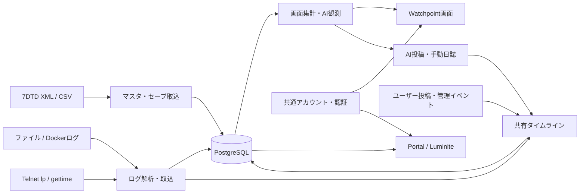

# リファクタリング前の全体調査

調査日: 2026-09-22。対象は未コミットの変更を含む現在の作業ツリーです。旧 `com.yuki.sevendays_states` から `com.yuki.rubinco` への移動・既存の削除は、今回の不要候補には数えていません。本調査ではアプリケーションコード・設定・DBを変更せず、この調査結果だけを追加しました。

## 全体構成と確認範囲

- 本番Java 191ファイル、16,193行。Javaテスト46ファイル、6,310行。
- Thymeleafテンプレート23ファイル、静的ファイル27ファイル、Flyway migration 39ファイル。
- Maven、application各プロファイル、Compose、デプロイスクリプト、GitHub Actions、運用文書も確認。
- 型名・メソッド名だけでなく、SQLのテーブル名、テンプレート、JavaScript、Springの自動実行入口を照合。

単一のSpring BootアプリケーションがPortal、Watchpoint、Luminiteを提供しています。PostgreSQLを共有し、認証はローカルのフォーム認証と本番のCognitoに分かれます。Luminiteは現状、共有サービスを使うTerrariaの画面です。

`@Scheduled`、`SmartLifecycle`、`@Bean`、JPA/Lombok、Thymeleafのプロパティ参照は、Javaから直接呼び出されなくても使用されます。以下の「参照なし」はこれらを考慮したリポジトリ内の静的な判定であり、外部利用や本番アクセスログまで確認した判定ではありません。

## 1. 削除候補として確度が高いもの

Javaパスの共通接頭辞は `src/main/java/com/yuki/rubinco/` です。

| ID | 対象・場所 | 根拠と整理範囲 |
| --- | --- | --- |
| A1 | Repositoryの検索メソッド6件（下表） | 本番・テストから利用なし。Repository自体やEntityは現用なので残す。 |
| A2 | パーサの `matches(String)` 5件（下表） | `parse(...).isPresent()` のラッパーで、本番・テストとも呼出なし。 |
| A3 | `watchpoint/ingest/SevenDaysDataProperties.java:66` の `gamePrefabsPath()` | 定義以外に参照なし。実際のPOI取込はGeneratedWorlds配下の `prefabs.xml` を使用する。 |
| A4 | `watchpoint/ingest/SevenDaysDataImportService.java:992` のprivate record `SourceReference` の `sourceArea` / `absolutePath` / `sizeBytes` | 格納されるだけで読み取りなし。構築箇所693・704行と一緒に縮小できる。ただしハッシュ生成に使うローカル変数 `sourceArea` と `size` は必要。 |
| A5 | `watchpoint/ingest/GameLogImportService.java:1385` のprivate record `ActivePlayer.joinedAt` | 初期化とコピーだけで判定・出力に利用なし。位置鮮度を判定する `positionUpdatedAt` は残す。 |
| A6 | 同 `GameLogImportService.java:408` の `saveLevelXpSummary` の `context` 引数 | メソッド内で未使用。呼出側198行と引数宣言を整理できる。 |
| A7 | `watchpoint/ai/WatchpointDiaryPublishingService.java:19` の `publishIfMissing(LocalDate)` と44行の `ALREADY_EXISTS` | メソッドは本番・テストとも未使用。状態値もこの入口専用。手動生成に使われる `publishNow()` は残す。 |
| A8 | `shared/web/WebAuthModelAdvice.java:50`・55・56のModel属性 | `currentAccountLogin` / `watchpointUrl` / `luminiteUrl` は現行テンプレート等に読み取りなし。削除候補はModelへの追加だけ。URL設定そのものは認証等で現用。 |
| A9 | `account/web/AuthenticationController.java:21` の `Model model` とimport | ログイン処理はリダイレクトだけでModel引数を使用しない。 |

A1の内訳:

| ファイル（`watchpoint/persistence/repository/`） | 行 | 未使用メソッド |
| --- | --- | --- |
| `M_GameConfigElementRepository.java` | 11 | `findByConfigName` |
| `M_GameSaveRepository.java` | 11 | `existsBySourceHash` |
| `M_WorldPoiRepository.java` | 11 | `findByWorldName` |
| `M_WorldSpawnPointRepository.java` | 11 | `findByWorldName` |
| `T_LevelXpSummaryTransactionRepository.java` | 11 | `findBySourceLogHash` |
| `T_SleeperTransactionRepository.java` | 9 | `existsBySourceLogHash` |

同じメソッド名が別Repositoryでは使用されているため、一括置換・一括削除はしません。

A2の内訳は `watchpoint/ingest/log/parser/` の `PlayerJoinLogParser.java:26`、`PlayerLeaveLogParser.java:26`、`EntityKillLogParser.java:24`、`ServerMetricLogParser.java:29`、`SleeperLogParser.java:30` です。`LevelXpSummaryLogParser.matches()` は `GameLogImportService.java:1229` で使用中です。

## 2. 現行機能から外れ、主に旧テストが保持しているもの

最もまとまった削減候補は旧タイムライン生成経路です。現行HTTP入口は `DashboardController.java:70` の `dashboard(false)` と72・86行の `TimelinePostService.feed()` を使用します。

| ID | 対象・場所 | 根拠と削除条件 |
| --- | --- | --- |
| B1 | `watchpoint/web/DashboardController.java:158` の `timeline(...)`、178行のリスト版 `timelinePage(...)`、199行の `curatedTimeline()`、253行の `sampledEvents()` と専用補助処理 | 本番入口から未到達で旧テストから使用。現役の189行 `timelinePage(FeedPage)` と `TimelineItem.post(TimelinePostService.PostView)` は残す。旧専用の定数・DTO変換・テストをまとめて整理する。 |
| B2 | `watchpoint/readmodel/DashboardViewService.java:43` の引数なし `dashboard()`、514行の `travelEntries()`、703行の `aggregateSleeperEncounters()`、739行の `condenseTimeline()` | 現画面は旧タイムライン生成を無効化している。514〜763行だけで約250行。B1と合わせ数百行規模の整理候補。`TravelEntry` 型、`eventTone()`、`EventMessageFormatter` はプレイヤー詳細でも使うため残す。旧経路専用の `TimelineEventPolicy.java` も同時に見直せる。 |
| B3 | `timeline/service/PlayerSocialService.java:16` の `feed()` と40行の旧 `PostView` | 現画面は `TimelinePostService.feed()` を使用。旧DTOはB1の互換コードとテストが主な利用先。投稿・リアクション・削除の委譲メソッドは現用で、クラス全体の削除対象ではない。 |
| B4 | `watchpoint/ai/AiCommentService.java:28` の `latestComment()` と36行の `latestBySourceType(String,int)` | テストのみ使用。前者の削除後は `watchpoint/ai/repository/T_AiCommentRepository.java:16` の `findTopByOrderByPublishedAtDesc()` も削減候補。1引数版 `latestBySourceType(String)` は現用。`findTop20BySourceTypeOrderByPublishedAtDesc()` はAI記憶初期化にも使用されるため残す。 |
| B5 | `src/main/resources/static/img/connection-monitor-avatar.png` | 参照は `DashboardControllerTests.java:224` のファイル存在確認のみ。現行ログイン/ログアウト表示は別のプロフィールアイコンを使用。他の画像、動的に選ばれるavatar SVGは残す。 |

旧コードのテストが通ることは、その機能が現画面で使われている根拠にはなりません。一方、テストを消すだけで整理を完了せず、引き続き必要な表示順・ページング・イベント保持の仕様は現行フィードのテストで確認します。

`publishNow(AiPostType)` など時刻・投稿種別を制御するための試験入口は別扱いです。テストだけから使われることを理由に機械的には削除せず、公開範囲の縮小やClock注入を検討します。

## 3. 実行されているが、不要な処理・重複があるもの

| ID | 対象・場所 | 現状と整理案 |
| --- | --- | --- |
| C1 | `watchpoint/readmodel/DashboardViewService.java:51` の車両取得 | ダッシュボード表示ごとに `vehicleStatuses()` を実行するが、`dashboard.html` は結果を使用しない。ダッシュボードからの取得とDTO項目を削減候補にする。1216行の車両詳細ページは同メソッドを使うため残す。 |
| C2 | `watchpoint/readmodel/WatchpointAiObservationService.java:40`・64 | `buildFullRequest()` で取得後、通常投稿では比較・集計・Blood Moon情報を破棄し、分析投稿ではイベント・POIを破棄する。日次要約ではさらに日次集計を再取得。投稿種類ごとに必要なSQLだけ実行する構造へ分ける。取得メソッドそのものは別用途で必要。性能効果の数値は未測定。 |
| C3 | `watchpoint/ingest/SevenDaysTelnetService.java:175` の `normalizeLpOutput()` | テスト2件だけが呼び、本番の74行以降の受信処理に似た正規化が別実装されている。実通信とテストが同じ処理を通るよう統合する候補。 |
| C4 | `account/security/GuestPrivacyService.java:18`・26 | 既に `app.css` を読むページへ、別バージョン文字列で同じCSSのlinkを追加する。CSS読込を共通headへ集約する候補。外部IDのマスキング、リンク制限、ゲストバッジは必要。ゲスト表示のCSS適用順を確認してから整理する。 |
| C5 | `src/main/resources/static/css/app.css:355`、433、489 | `account-list/row`、`leader-grid/card`、`score-trend-panel`、`score-chart`、`score-legend` は現テンプレート・JS・Javaに利用が見当たらない。関連する共通セレクタやメディアクエリも含めて削減候補。動的な `tone-*` / `status-*` まで一括削除しない。ブラウザでの表示確認は未実施。 |

## 4. 利用目的・運用状態を確認してから判断するもの

**取り込むだけで、画面・AIでの利用が確認できないデータ**

`SevenDaysDataImportService` が保存する次の7種類は、リポジトリ内では取込時のupsert・重複判定以外の読み取りを確認できませんでした。

| テーブル | 取込箇所（同Service） |
| --- | --- |
| `M_GAME_CONFIG_ELEMENT` | 180行 |
| `M_BLOCK` | 252行 |
| `M_ITEM` | 270行 |
| `M_VEHICLE` | 287行 |
| `M_GAME_SAVE` | 486行 |
| `M_WORLD_SPAWN_POINT` | 428行 |
| `T_PLAYER_MARKER_SNAPSHOT` | 589行 |

外部分析・原データ保存・予定機能のために必要なら残します。不要と判断した場合は、まず取込を縮小し、既存データの廃棄やテーブル削除は別に判断します。`T_PLAYER_STATE_SNAPSHOT` は画面集計で現用です。

**旧データ・互換処理**

- `T_PLAYER_POST` / `T_PLAYER_POST_LIKE`: 現役のJava Entity/Repositoryは既に除去されています。V23の34行以降で共有タイムラインに移行する旧テーブルです。データ保持の判断後、新規migrationで削除を検討できます。V23を再実行すると、後から削除された投稿まで復元するおそれがあるため、再移行はしません。
- `infrastructure/persistence/FlywayV15ChecksumRepairCallback.java:19`: 既知の本番履歴修復用。未使用クラスではなくFlywayのコールバックです。対象環境・復元用バックアップのV15履歴がすべて整理済みと確認できた時点で廃止候補になります。
- `scripts/deploy-app.sh` と `.github/workflows/deploy-rubinco.yml`: 手動のソースcheckout配置と、SSM経由の成果物配置という2系統です。ヘルスチェック・ロールバックが重複するため運用統一候補ですが、現用経路が異なるので片方を即削除しません。
- `/community`、旧 `/maintenance/accounts`、`/posts/*/like`・`like.json` などの互換ルート: 新画面から参照されなくても外部クライアントやブックマークの入口になり得ます。必要性はアクセス実績と互換方針で判断します。

## 5. 全体リファクタリングで分割・統合する候補

| 対象 | 現状 | 推奨する境界 |
| --- | --- | --- |
| `DashboardViewService` | 1,766行。プレイヤー、サーバー、討伐、移動、車両、探索、日誌、旧タイムラインを所有 | 旧経路を除去した後、画面用途ごとの読み取りサービスへ分割する。 |
| `GameLogImportService` | 1,436行。解析振分け、同一人物判定、状態更新、距離・運転者推定、投稿生成 | 同定、移動判定、イベント保存などの規則ごとに分割。現在状態と過去イベントの時系列条件を維持する。 |
| `SevenDaysDataImportService` | 1,035行。XML/CSV、マスタ、ワールド、セーブ取込 | 取込対象ごとに分割。まず不要な保存対象を確定する。 |
| `BedrockWatchpointClient` / `BedrockDiaryClient` / `BedrockMarkClient` | 通信・応答テキスト連結・JSON切出しが重複し、JSON抽出の実装も異なる | 通信とJSON抽出を共有し、用途別のプロンプト・検証は個別に保つ。 |
| Blood Moonの取得・解釈 | DashboardViewService:1421、DiaryMaintenanceService:197、WatchpointAiObservationService:358に分散 | 時点指定の取得・解釈を共有し、画面/日誌/AI向け表現を分ける。 |
| Telnet接続処理 | SevenDaysTelnetService:51とSevenDaysTelnetCommandClient:34に接続・認証・切断処理が分散 | 接続管理を共有し、`lp/gettime` と送信コマンドそれぞれの応答終了条件は分ける。 |
| セキュリティ設定 | WebSecurityConfigとCognitoSecurityConfigに権限・ヘッダー設定の重複 | 共通の認可規則・ヘッダーを整理し、フォーム/OIDC/JWTの差分を維持する。 |

**設定の二重管理で注意する点:** `SevenDaysDataProperties.java:82`・88・112のスケジュール項目はrecord側で既定値や下限を補正しますが、Runnerの `@Scheduled` は `${...}` から設定を直接読みます。例えばTelnetの最低60秒補正（128行）は `SevenDaysTelnetPlayerStateRunner.java:18` の設定読込経路に反映されません。これは単に項目を消すのではなく、設定取得・検証を統一する対象です。設定を変更した実機での再現検証は今回行っていません。

## 6. compose.example.yml と削除しないもの

`compose.example.yml` は16行でPostgreSQLだけを定義しており、不要なサービスはありません。

- 7行のDB名 `seven_days_stats` は `application.yml:6` と一致。
- 11行の `127.0.0.1:5432:5432` は、ホストで動くSpring BootからDBへ接続する構成で使用。
- 13・16行の `postgres_data` はDBの永続領域。
- `RUNNING.md:45`、`docs/PORTAL_MVP.md:226` とsystemd例から起動手順へ接続している。
- `seven-days-postgres` などの旧名称は既存インフラとの互換性を保つために残っている。Rubincoへの名称統一だけを理由にコンテナ・DB・volumeを変更しない。

ほかにも、以下は削除候補から除外します。

- ローカル認証一式: Cognito未使用の開発環境で必要。
- `*-test.html` とAI管理Controller: 名前にtestがあっても、管理者が使う現役の画面。
- `MockGameServerStartGateway`: 現在選択されている起動操作の実装。未完成の実EC2連携と置き換えずに削除できない。
- `M_WEB_ACCOUNT` と `M_PLAYER`: 共通アカウントと7DTDの識別情報で責務が異なる。
- `T_AI_COMMENT` と `T_TIMELINE_POST`: 日誌・AIコンテンツと公開フィードの役割が異なる。
- current stateと履歴テーブル: 最新状態表示と過去イベントの集計にそれぞれ必要。
- 適用済みFlyway migration: 過去の変更履歴なので、似たSQLがあっても削除・統合しない。
- `pom.xml` の主要依存関係: MVC、テンプレート、OIDC/JWT、validation、JPA/Flyway/PostgreSQL、Telnet、Bedrock/S3、Lombok、テストで現用。`flyway-core` は推移依存でも入るが直接APIを使用しており、不要ライブラリとは扱わない。

## 確認結果と着手順

実行した確認:

- Java 21で `./mvnw test`: **247件成功、失敗0、エラー0、スキップ0**。
- `node --test src/test/js/timeline.test.cjs`: **5件成功、失敗0**。
- Mavenログ: `/tmp/rubinco-refactor-audit-maven.log`。Nodeログ: `/tmp/rubinco-refactor-audit-node.log`。

DBを使う既存テストはH2のPostgreSQL互換モードです。本番PostgreSQL、実AWS、稼働中ゲームサーバー、実ブラウザでの確認は実施していません。テスト成功は整理前の基準であり、削除後の動作を保証するものではありません。

推奨順は **Aの小さな未使用コード → Bの旧タイムライン経路 → Cの不要な取得・重複 → 大きなServiceの分割 → 保存データ・互換機能の廃止判断** です。各段階で関連する既存テストと現行画面の動作を確認することで、削除と仕様変更を切り分けられます。
